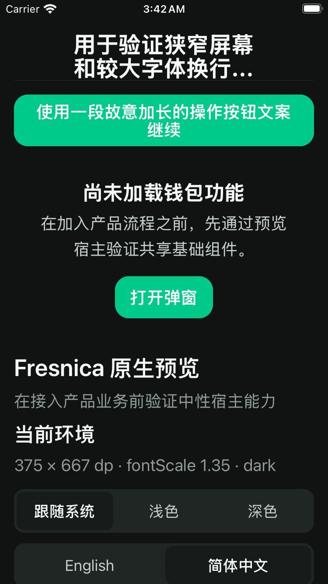
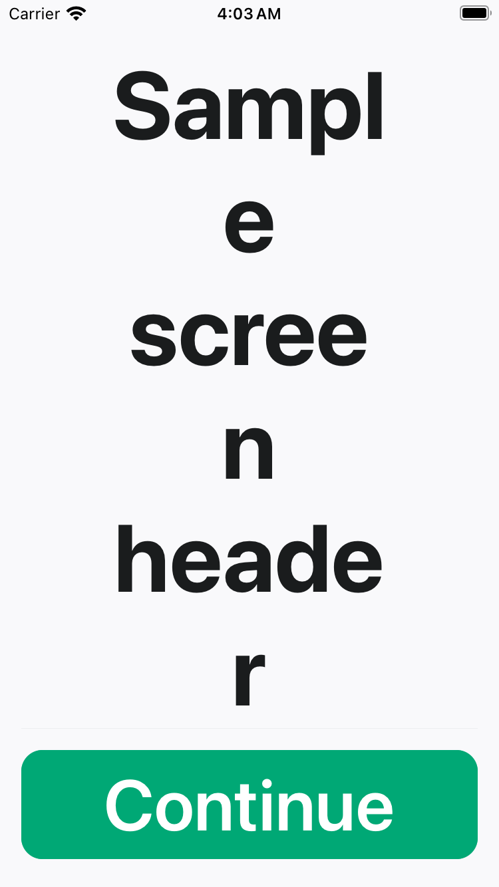
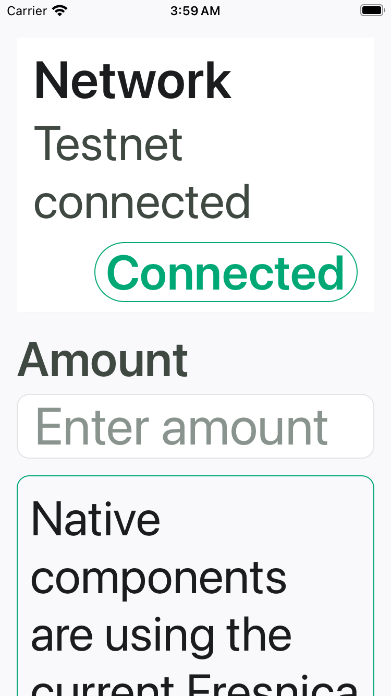
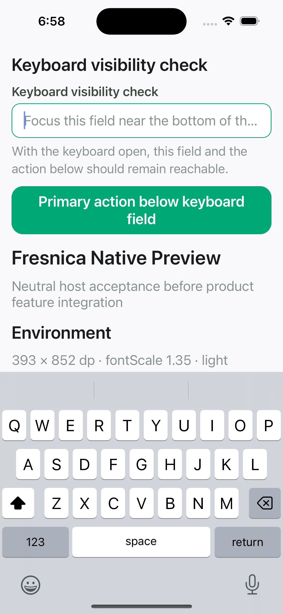

# iOS layout review — 2026-10-15

**Technical review:** complete for the visible archived frames. Reviewer: Codex assistant,
2026-10-15. The seven original artifact ZIP digests were checked before extracting their
unchanged PNG and metadata bytes into this repository. `node scripts/verify-ios-evidence.mjs` checks the
retained files against their individual SHA-256 values and recorded environment.

**Project-owner design decision:** pending. No owner approval, reviewer name, approval date or
approved iOS Golden Baseline is inferred from the request to complete engineering work.

## Scope for the owner decision

The five candidate frames below concern layout at the recorded text sizes: Header wrapping,
ListRow trailing placement, Modal content and the keyboard-constrained action area. The first
two older top-frame captures in the manifest are retained as historical context, not proposed
as additional current-layout approval frames.

Colors/contrast, VoiceOver, physical devices, real-device keyboard/autofill, iPad, product
flows and release acceptance remain excluded. The existing Modal fade is unchanged.

The originals live under [ios/2026-10-15](ios/2026-10-15). Metadata `sourceSha` records the
workflow checkout/merge SHA; it is preserved separately from PR-head and merged-main SHAs.

| Record                | Value                                                                             |
| --------------------- | --------------------------------------------------------------------------------- |
| Technical reviewer    | Codex assistant                                                                   |
| Technical review date | 2026-10-15                                                                        |
| Owner reviewer        | Pending actual decision                                                           |
| Owner review date     | Pending actual decision                                                           |
| Owner decision        | Pending: accept the listed layout scope or identify changes                       |
| Candidate evidence    | S03 actions; S04 actions/content; S05 Modal; S06 keyboard                         |
| Reference manifest    | [Exact sources, checksums and environments](ios-simulator-evidence-manifest.json) |

## S03 maximum-standard action layout

The long Chinese Header retains the existing two-line ellipsis at this text category. The
long action label wraps within its button. This records current behavior; the owner decision
includes whether the existing density and title truncation are acceptable in this example.

## S04 maximum-accessibility Header layout

The Header no longer ends in a two-line ellipsis. At this extreme size, the narrow title
column breaks words across several short lines and occupies most of the frame. All title
characters and the Continue action are visible. The owner still needs to assess this layout;
technical visibility alone does not establish design preference.

## S04 maximum-accessibility ListRow layout

The Connected badge sits below the title/description, leaving the text column usable. The
lower message continues beyond this captured viewport; the screenshot does not independently
prove the rest of its scroll behavior.

## S05 maximum-accessibility Modal

The Chinese title, explanatory content and explicit close button are visible. The separate
top-right close glyph is clipped by its former fixed 44-point box. The engineering closeout
changes that box to minimum dimensions so it can grow; a new S05 capture must verify the fix
before the replacement frame is proposed for owner approval. This older frame is historical.

## S06 software keyboard

The software keyboard is visibly present. The focused input, supporting copy and primary
action appear above it. The long placeholder is truncated within a single-line input.
This frame does not prove actual button activation, VoiceOver focus or real-device behavior.

## 中文审阅说明

请审阅上面五张原始画面的布局：普通较大字号下的标题省略、最大辅助字号下标题的多行
换行、列表尾部标签移到下方、弹窗内容和关闭控件，以及键盘上方的输入框和主要按钮。
当前已完成技术复核，项目所有者的设计认可保持待确认。可以接受上述范围，也可以指出
具体需要调整的画面与位置。确认后只更新实际审核人、日期、范围和决定。

本次不审核配色与对比度，不恢复真机或 VoiceOver 验收，也不改变 Modal fade。
